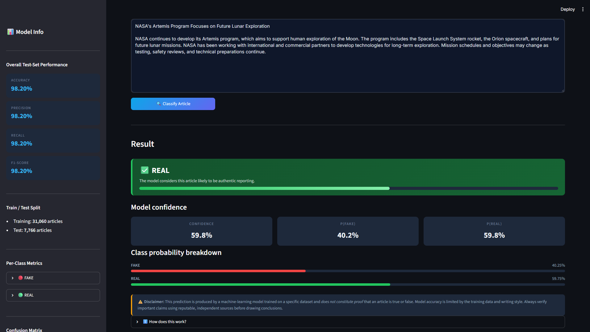
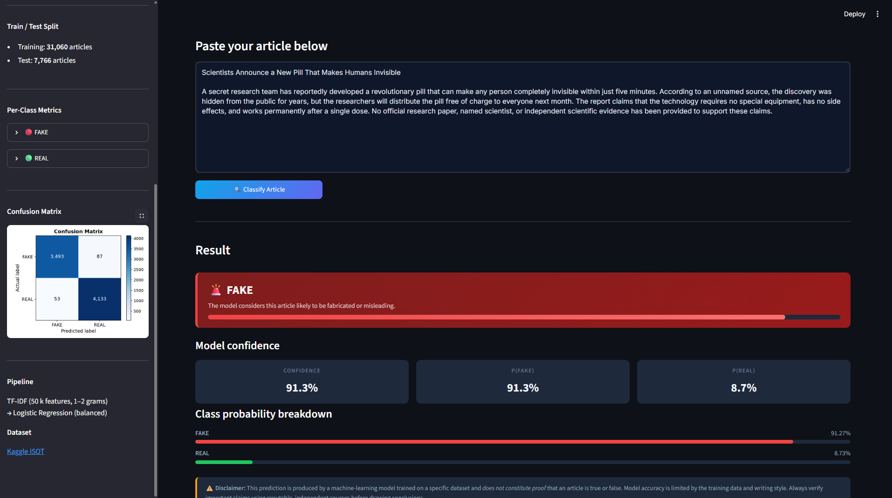

# News Article Classification (Fake / Real)

An AI/ML internship project that classifies news articles as **FAKE** or **REAL** using Natural Language Processing (NLP) and Machine Learning. The project uses TF-IDF for feature extraction, Logistic Regression for classification, and an interactive Streamlit web application for testing predictions.

---

## 📌 Project Overview and Objective

With the volume of information shared online every day, distinguishing credible news from misleading or fabricated stories has become increasingly important. 

**Objective:**  
The goal of this project is to build an end-to-end, reproducible text classification pipeline that:
- Preprocesses news headlines and body text to reduce noise.
- Converts text into numerical features using Term Frequency-Inverse Document Frequency (TF-IDF).
- Trains and evaluates a Logistic Regression classifier on held-out test data.
- Provides a clean, user-friendly Streamlit web app where users can paste an article and view the prediction with confidence scores.

---

## 🛠️ Tools and Libraries Used

- **Python**: Primary programming language for data processing and model building.
- **Pandas**: Used for loading CSV datasets, merging headlines and text, and data cleaning.
- **NumPy**: Numerical operations and array handling.
- **Scikit-learn**:
  - `TfidfVectorizer` for text feature extraction.
  - `LogisticRegression` for classification.
  - `train_test_split` for reproducible, stratified dataset splitting.
  - `Pipeline` to chain vectorization and classification without data leakage.
  - Evaluation metrics: `accuracy_score`, `precision_score`, `recall_score`, `f1_score`, `classification_report`, and `confusion_matrix`.
- **Matplotlib**: Generating and saving the confusion matrix visualization.
- **Joblib**: Serializing and loading the trained pipeline (`.joblib`).
- **Streamlit**: Building the interactive web application.

---

## 📂 Dataset Source and Expected File Names

This project is designed around the popular **ISOT Fake and Real News Dataset** from Kaggle:
- **Download link:** [Kaggle Fake and Real News Dataset](https://www.kaggle.com/datasets/clmentbisaillon/fake-and-real-news-dataset)

### Expected Files in `data/`:
Place your dataset files inside the `data/` folder in either of the following formats:

1. **Option A (Recommended - Dual CSVs):**
   - `data/Fake.csv` (or `data/Fake.csv.zip`) – contains fake news articles.
   - `data/True.csv` (or `data/True.csv.zip`) – contains authentic news articles.
   *(The script automatically assigns `FAKE` and `REAL` labels to each respective file).*

2. **Option B (Single CSV fallback):**
   - `data/news.csv` – must contain a `text` column (article body) and a `label` column with values `FAKE` and `REAL`.

*(Note: Raw dataset CSV files are not tracked in version control to keep repository size light).*

---

---

## 📷 Screenshots

| Real News Detection | Fake News Detection |
|:---:|:---:|
|  |  |

---

## 📁 Project Folder Structure

```
News-Article-Classification/
├── app.py                  # Streamlit web application interface
├── train_model.py          # Data preparation, model training, evaluation & saving
├── review.py               # Automated 85-check project audit & test suite
├── requirements.txt        # Required Python packages
├── README.md               # Project documentation and guide
├── REPORT_TEMPLATE.md      # Final internship report template (ready for PDF export)
├── Screenshort/            # Web application user interface screenshots
│   ├── Fake_Article.png
│   └── Real_Article.png
├── data/                   # Dataset folder (place Fake.csv and True.csv here)
│   └── .gitkeep
└── models/                 # Saved artifacts generated during training
    ├── news_classifier.joblib  # Trained scikit-learn pipeline (TF-IDF + model)
    ├── metrics.json            # Test set evaluation metrics for the Streamlit sidebar
    └── confusion_matrix.png    # Saved confusion matrix chart
```

---

## ⚙️ Installation Instructions

1. **Clone or download** this project folder to your local computer.
2. **Open a terminal** (PowerShell, Command Prompt, or terminal) and navigate into the project directory:
   ```bash
   cd News-Article-Classification
   ```
3. *(Optional but recommended)* Create and activate a virtual environment:
   ```bash
   # Windows
   python -m venv venv
   .\venv\Scripts\activate
   ```
4. **Install all required libraries:**
   ```bash
   pip install -r requirements.txt
   ```

---

## 🚀 Exact Commands to Run

### Step 1: Train the Model
Make sure `Fake.csv` and `True.csv` are placed inside the `data/` folder, then run:
```bash
python train_model.py
```
**What happens when you run this:**
- The script loads and cleans the dataset (removes duplicates, empty texts, and invalid entries).
- Displays dataset summary statistics and class distribution.
- Splits the dataset into 80% training and 20% testing sets using stratification.
- Fits the TF-IDF vectorizer and trains the Logistic Regression classifier.
- Evaluates the model on the held-out 20% test set and prints Accuracy, Precision, Recall, F1-score, and a confusion matrix.
- Saves the trained pipeline to `models/news_classifier.joblib` along with `models/metrics.json` and `models/confusion_matrix.png`.

### Step 2: Launch the Streamlit App
After training completes, start the web interface:
```bash
python -m streamlit run app.py
```
*(or `streamlit run app.py` if Streamlit is registered directly in your system PATH).*

Once launched, your terminal will display a local address:
```
Local URL: http://localhost:8501
```
Open that URL in your browser, paste any news headline and article text into the input box, and click **Classify Article**.

---

## 🧠 Methodology Overview

1. **Data Preprocessing & Cleaning:**
   - Combines the `title` and `text` columns into a unified `content` field.
   - Cleans the text by converting it to lowercase, stripping URLs (`http/https`), removing HTML tags, filtering out bare digits, and normalizing whitespace.
   - Drops duplicate articles and articles with less than 10 characters to prevent skewed results.

2. **Stratified Train / Test Split:**
   - The data is split into 80% training data and 20% testing data using `random_state=42` and `stratify=data['label']`.
   - Stratification ensures both training and testing sets maintain the exact same ratio of fake to real news articles.

3. **TF-IDF Feature Extraction:**
   - Uses `TfidfVectorizer` with `ngram_range=(1, 2)` to capture both individual words and two-word phrases.
   - Restricts features to the top 50,000 terms (`max_features=50000`).
   - Uses `sublinear_tf=True` (logarithmic scaling $\log(1 + \text{tf})$) to prevent long articles with frequent repeated words from dominating the feature weights.
   - Filters common English stopwords and words appearing in only one document (`min_df=2`).

4. **Classification with Logistic Regression:**
   - Logistic Regression is chosen because it performs strongly on high-dimensional sparse text representations, converges quickly, and outputs well-calibrated class probabilities via `predict_proba()`.
   - Uses `class_weight='balanced'` and `max_iter=1000` to ensure stable convergence.

5. **Data Leakage Safeguard:**
   - A scikit-learn `Pipeline` chains the vectorizer and classifier. The vectorizer is **fitted only on the training set**. The test set is only transformed during evaluation, ensuring zero leakage of test vocabulary into training.

---

## 📊 Evaluation Metrics and Calculation

To evaluate classification performance objectively, metrics are calculated **strictly on the held-out 20% test set**:

- **Accuracy:** The percentage of total test articles correctly identified as fake or real:
  $$\text{Accuracy} = \frac{TP + TN}{TP + TN + FP + FN}$$
- **Precision:** Of all articles predicted as a given class, how many were actually that class:
  $$\text{Precision} = \frac{TP}{TP + FP}$$
- **Recall:** Of all articles that genuinely belonged to a class, how many did the model identify:
  $$\text{Recall} = \frac{TP}{TP + FN}$$
- **F1-Score:** The harmonic mean of Precision and Recall, balancing false positives and false negatives:
  $$\text{F1-Score} = 2 \times \frac{\text{Precision} \times \text{Recall}}{\text{Precision} + \text{Recall}}$$
- **Confusion Matrix:** A $2 \times 2$ table showing True Positives, True Negatives, False Positives, and False Negatives, saved as `models/confusion_matrix.png` and displayed in the app sidebar.

---

## ⚠️ Limitations & Ethical Considerations

- **Dataset Bias:** The model learns stylistic markers, vocabulary patterns, and source conventions present in its training dataset (e.g., Reuters formatting conventions). Changes in writing style or new topics may affect performance.
- **Not a Fact-Checking Replacement:** Machine learning classifiers evaluate textual similarity and vocabulary patterns—they do not have real-time internet search capabilities, access to primary sources, or ontological truth verification.
- **Verification Notice:** Important, sensitive, or viral claims must always be verified through credible, established journalistic organizations and independent fact-checking platforms.
